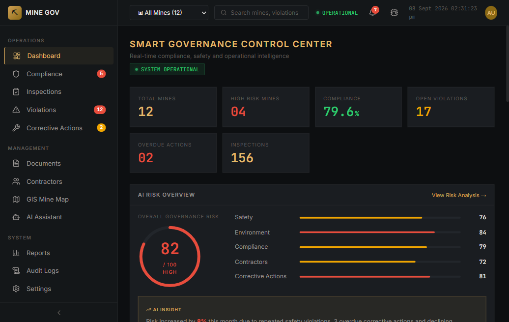
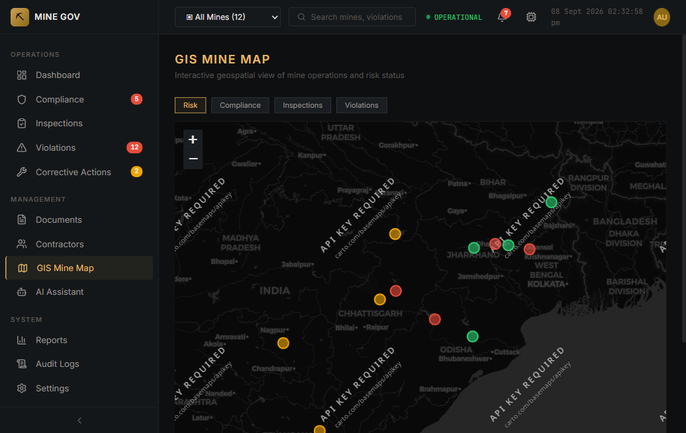
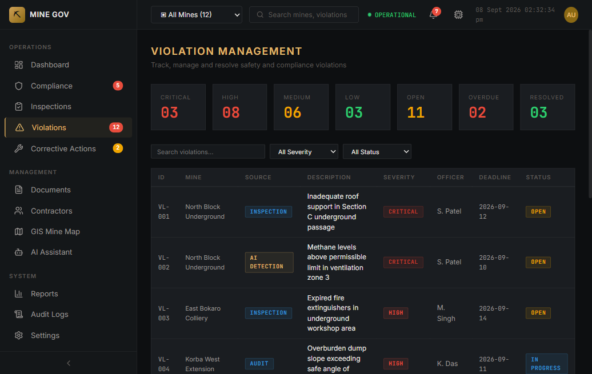
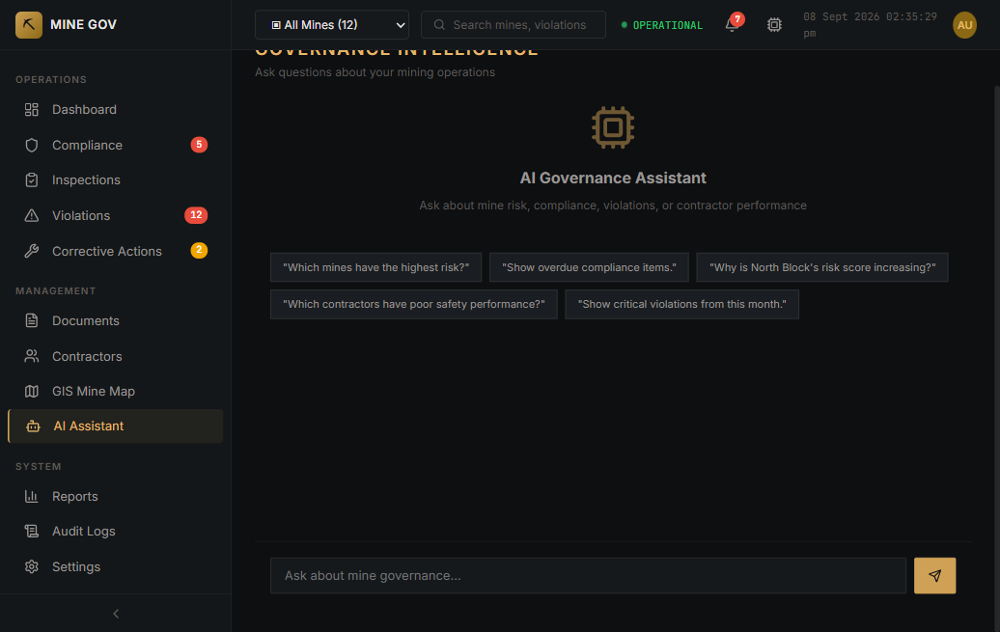
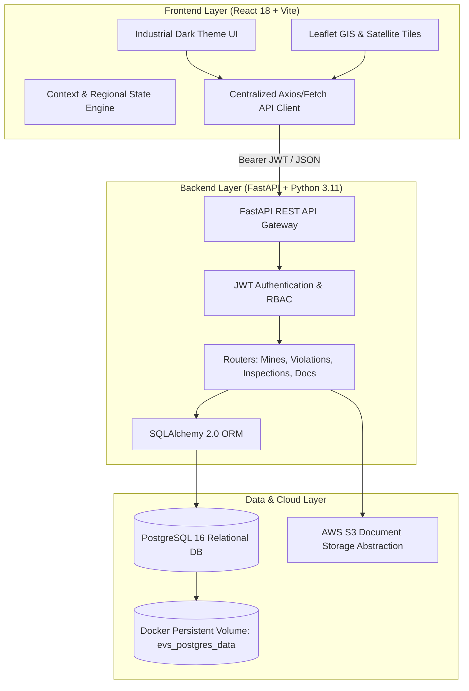

# 🏔️ GeoMine AI — Smart Mining Governance & GIS Compliance Platform

<div align="center">



[](https://reactjs.org/)
[](https://vitejs.dev/)
[](https://fastapi.tiangolo.com/)
[](https://www.postgresql.org/)
[](https://www.docker.com/)
[](https://opensource.org/licenses/MIT)

**An enterprise-grade AI-powered mining governance, spatial intelligence, and statutory compliance management platform designed for state geology departments, environmental regulators, and mine safety inspectors.**

[Features](#-key-features) • [Architecture](#-system-architecture) • [Live Screenshots](#-visual-walkthrough) • [Getting Started](#-getting-started) • [Database Schema](#-database-schema) • [API Documentation](#-api-endpoints)

---

</div>

## 📌 Executive Summary

Traditional mining compliance and field audits suffer from disconnected paper documentation, delayed risk reporting, lack of real-time coordinate verification, and fragmented inter-agency coordination. 

**GeoMine AI** modernizes regional mining administration by uniting **real-time GIS spatial mapping**, **standardized digital field inspections**, **automated OCR document verification**, and **AI-driven risk scoring** into a unified, high-density industrial command center backed by a resilient **PostgreSQL** relational engine.

---

## ⚡ Key Features

### 1. 📊 Executive Governance Dashboard
* **Dynamic KPI Telemetry**: Instant district-wide insights on active leases, extraction volumes, average compliance rates, and high-risk quarry watchlists.
* **Predictive Risk Trends**: Recharts-powered temporal analysis monitoring violation surges and safety score trends across extraction quarters.
* **Prioritized Attention Feed**: Immediate action alerts for impending lease expirations, overdue penalties, and boundary infringement notifications.

### 2. 🗺️ High-Precision GIS Spatial Intelligence
* **Multi-Layer Topography**: Seamless switching between high-resolution CartoDB/Esri satellite imagery, OpenStreetMap streets, and terrain topologies.
* **Geographic Boundary Plotting**: Dynamic GeoJSON boundary projection for 38 administrative districts across Tamil Nadu.
* **GPS Coordinate Calibration**: Real-time pinpointing of 146+ verified mining nodes with color-coded risk markers and interactive popup telemetry cards.

### 3. 🛡️ Dual-Panel Field Inspection Console
* **Full-Width Standardized Workflow**: Step-by-step statutory safety audit following Directorate General of Mines Safety (DGMS) guidelines.
* **Live Spatial Context Node**: Side-by-side inspection console displaying real-time satellite photos, GPS watermarking, active violation watchlists, and historical audit logs.
* **Photographic Evidence Vault**: Upload field evidence photos with client/server validation, automated storage persistence, and tamper-evident SHA-256 digital stamping.

### 4. 🚨 Violation & Corrective Action Tracking
* **Centralized Infraction Register**: Track legal, safety, and environmental violations classified by severity (`CRITICAL`, `HIGH`, `MEDIUM`, `LOW`).
* **Enforcement Lifecycle**: Manage the end-to-end workflow from show-cause citation issuance to verified resolution with penalty auditing.

### 5. 📄 Statutory Document OCR & Vault
* **Automated Metadata Extraction**: Extract permit numbers, issuing authorities, lease start/end dates, and maximum extraction caps from PDFs and imagery.
* **Confidence Scoring**: Field-by-field OCR reliability assessment with manual officer override before committing to PostgreSQL.

---

## 📸 Visual Walkthrough

<div align="center">

### Spatial Intelligence & GIS Map


### Statutory Violations & Enforcement Register


### AI Risk Intelligence Assistant


</div>

---

## 🏗️ System Architecture



---

## 💻 Tech Stack

| Domain | Technology | Description |
|---|---|---|
| **Frontend Framework** | **React 18** | High-performance single-page architecture |
| **Build & Tooling** | **Vite 5** | Lightning-fast HMR and optimized asset bundling |
| **Styling & Theme** | **Industrial Dark CSS** | High-density control room design (`#111318`, `#c8956c`) |
| **GIS & Mapping** | **Leaflet / React-Leaflet** | Interactive geospatial mapping with Esri World Imagery |
| **Data Visualization** | **Recharts** | Reactive time-series risk trends and compliance gauges |
| **Icons** | **Lucide React** | Consistent, modern enterprise iconography |
| **Backend Framework** | **FastAPI** | High-throughput asynchronous Python REST framework |
| **Database & ORM** | **PostgreSQL 16 + SQLAlchemy** | Enterprise relational storage with automated schema seeding |
| **Validation** | **Pydantic v2** | Strict request/response payload schema validation |
| **Containerization** | **Docker & Docker Compose** | Multi-container unified orchestration |
| **Cloud Target** | **AWS (Amplify + ECS + S3)** | Cloud-native deployment blueprint ready |

---

## 🚀 Getting Started

### Option 1: One-Click Launch via Docker Compose (Recommended)

Make sure you have **Docker Desktop** installed and running on your machine:

```bash
# Clone the repository
git clone https://github.com/AshwanthShanmuganathan/GEOMINE---AI-.git
cd GEOMINE---AI-

# Start both PostgreSQL and FastAPI in background containers
docker compose up --build -d
```

Once started:
* **Frontend**: Open `http://localhost:5173` (run `npm run dev`)
* **Backend API**: Accessible at `http://localhost:8000/api`
* **Swagger Interactive Docs**: Accessible at `http://localhost:8000/docs`
* **PostgreSQL Database**: Running on `localhost:5432` (database: `geomine_db`, user: `geomine_user`)

---

### Option 2: Manual Local Setup

#### 1. Backend Setup (FastAPI & PostgreSQL)

```bash
cd backend

# Create and activate Python virtual environment
python -m venv venv
# On Windows:
.\venv\Scripts\activate
# On Linux/macOS:
source venv/bin/activate

# Install dependencies
pip install -r requirements.txt

# Configure environment variables
cp .env.example .env
# Edit .env with your PostgreSQL credentials (e.g. Neon or local Postgres)

# Start the FastAPI server
uvicorn app.main:app --host 0.0.0.0 --port 8000 --reload
```

#### 2. Frontend Setup (React & Vite)

```bash
# From project root:
npm install

# Start Vite development server
npm run dev
```

Visit `http://localhost:5173` to explore the GeoMine AI console.

---

## 🔑 Default Credentials & Demo Context

The database is pre-seeded with 38 Tamil Nadu districts, 146 active mining leases, and statutory baseline records:

* **Inspector Email**: `admin@gmail.com`
* **Password**: `admin123`
* **Role**: `Senior Safety Inspector (Class-I Officer)`
* **Active Jurisdiction**: Pudukkottai, Karur, Salem, Coimbatore, Ariyalur Extraction Zones

---

## 🗄️ Database Schema

The PostgreSQL database enforces relational integrity and foreign-key constraints:

* `districts`: 38 administrative districts with geographic center coordinates and risk counts.
* `mines`: 146 verified quarries with exact latitude/longitude, extraction type, operator, and risk scores.
* `violations`: Statutory citations with severity levels, deadlines, financial penalties, and status.
* `inspections`: Audit records with checklist pass ratios, inspector identities, and uploaded photo evidence paths.
* `compliance_items`: Statutory environmental and safety requirements with frequency and due dates.
* `contractors`: Logistics and extraction service providers with safety scores and license statuses.
* `documents`: Regulatory permits, mine plans, and environmental clearances with OCR metadata.
* `audit_logs`: Immutable security ledger tracking all user actions, logins, and status updates.

---

## 🔌 API Endpoints Summary

| Method | Endpoint | Description |
|---|---|---|
| `GET` | `/api/health` | Health check and live DB connectivity status |
| `POST` | `/api/auth/token` | User login and JWT Bearer token generation |
| `GET` | `/api/districts` | Retrieve all 38 administrative districts |
| `GET` | `/api/mines` | Filtered list of registered quarries by district |
| `GET` | `/api/mines/{id}` | Detailed quarry profile with coordinates and operations |
| `GET` | `/api/violations` | Multi-filter violations query (severity, mine, status) |
| `POST` | `/api/violations` | Create and file a new statutory violation |
| `GET` | `/api/inspections` | Inspection logs with checklist scores |
| `POST` | `/api/inspections` | Submit new field audit with evidence watermark |
| `POST` | `/api/upload` | Multipart file evidence upload to persistent volume |
| `GET` | `/api/documents` | Regulatory permits and OCR extracted records |
| `GET` | `/api/contractors` | Third-party mining contractor safety register |
| `GET` | `/api/audit-logs` | Immutable system audit log trail |

---

## 🛡️ Security & Compliance Standards

* **Statutory DGMS Compliance**: Adheres to Directorate General of Mines Safety regulations for open cast pit stability, dust suppression, and worker PPE standards.
* **Evidence Admissibility**: Field photographs and inspection records are signed with cryptographic SHA-256 hashes to support compliance with Section 65B of the Indian Evidence Act.
* **Environment-Segregated Secrets**: Zero credentials committed to version control; runtime injection through Docker environment variables.
* **Role-Based Access Control (RBAC)**: Fine-grained access control securing inspector consoles against unauthorized tampering.

---

## 👥 Contributors

* **Ashwanth Shanmuganathan** — Lead Architecture & Development
* **GeoMine AI Project Team**

---

## 📄 License

This project is licensed under the [MIT License](LICENSE).
